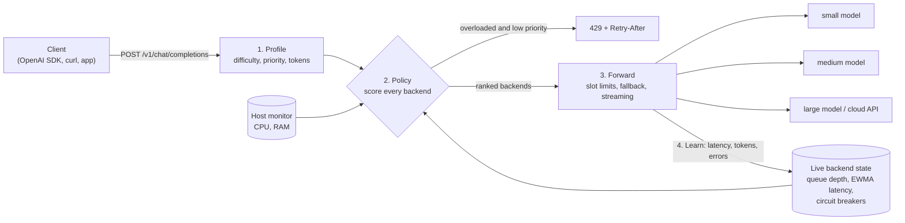

# llm-triage

**Send every LLM request to the right model: easy prompts to small models, hard prompts to big ones, and nothing to a model that is already overloaded.**

llm-triage is an OpenAI-compatible router that sits in front of several model servers (Ollama, llama.cpp, vLLM or a cloud API) and decides, for each request, which one should answer. It weighs how hard the prompt is, how busy each backend is right now, how loaded your machine is, how important the request is and what it would cost. Every decision is explained in the response headers and on a live dashboard.

```
$ curl -si localhost:8080/v1/chat/completions -d '{"model":"auto","messages":[...]}'
x-triage-backend: large
x-triage-difficulty: 0.755
x-triage-reason: tier 3 meets need 3; predicted 11.94s
```

## Why

Serving LLMs on limited hardware usually forces a bad trade-off:

- **One big model for everything.** Good answers, but a queue builds as soon as a few requests arrive at once, and a "what's the capital of France?" waits behind a 400-token code review.
- **One small model.** Fast, but poor at anything hard.
- **Several models behind a round-robin load balancer.** Hard prompts land on the small model by chance, and easy prompts tie up the big one.

The real question is per request: *which model is good enough for this prompt and can answer soonest, given everything else that is happening?* llm-triage answers it in well under a millisecond, without calling a model to decide.

## Inspiration, and how this differs

This project was inspired by [RAMP (resource-aware-model-proxy)](https://github.com/shivapreetham/resource-aware-model-proxy), which watches RAM, VRAM and disk and swaps a single local model up or down a quality ladder as memory pressure changes. llm-triage tackles the same underlying problem, serving LLMs well on constrained resources, from a different angle:

| | RAMP | llm-triage |
|---|---|---|
| What is decided | which **one** model is loaded on the machine | which of **several** running models answers **each request** |
| Signals | free RAM, VRAM, disk | prompt difficulty, per-backend queue depth and measured latency, host CPU/RAM, request priority, cost |
| When overloaded | swaps to a smaller model; requests wait during the swap | spills to other backends; rejects low-priority work early with `429` |
| When a backend fails | falls through to smaller tiers | per-backend circuit breaker and automatic fallback to the next-best backend |

The two are complementary: RAMP decides what fits in memory, and llm-triage decides where each request should go among what is running.

## How it works



**1. Profile** ([classifier.py](src/triage/classifier.py)). A difficulty score from 0 to 1 is built from named signals: reasoning phrases ("step by step", "prove", "debug", "compare"...), code, math, prompt length, conversation length and requested output length. It takes microseconds and every point is traceable:

```
$ triage classify "Debug this step by step: ```def f(x): return 1/x```"
  "difficulty": 0.652,
  "signals": ["reasoning:step by step,debug", "code"],
  "required_tier_of_3": 3
```

Clients can also send `x-priority: low|normal|high`, pin a backend with `"model": "<backend name>"`, or demand a minimum tier with `x-triage-min-tier`.

**2. Decide** ([policy.py](src/triage/policy.py)). A pure function with no I/O, so every branch is unit-tested with made-up numbers. Difficulty is mapped onto the tier ladder, then each healthy backend gets a score (lower wins):

```
score = quality   w_q * P_q * max(0, need - tier)          model too weak for the prompt
      + overkill  w_o * max(0, tier - need)                big model wasted on an easy prompt
      + latency   w_l * P_l * predicted_latency / SLO      queue wait + service time
      + pressure  w_p * host_pressure * weight             only for models on this machine
      + cost      w_c * expected_cost / cost_ref
```

`predicted_latency` combines the backend's measured seconds per token, the expected output length, and a queue-wait estimate from its in-flight and queued requests. `P_q` and `P_l` depend on priority, so high-priority requests insist on quality and low-priority ones accept a small model. Before scoring, **admission control** rejects low-priority requests once the fleet is 80% busy (normal priority at 150%; high priority is never rejected).

When the right model is busy, triage degrades on purpose, and says so:

```
"degraded to tier 2 (need 3): large scored 4.44 vs 1.48, predicted 44.36s vs 4.78s"
{"name": "medium", "score": 1.4776, "terms": {"quality": 1.0, "overkill": 0.0, "latency": 0.4776, "pressure": 0.0, "cost": 0.0}}
```

When the laptop itself is busy (here 95% CPU), heavy local models are penalised:

```
"degraded to tier 2 (need 3): large scored 2.03 vs 1.98, predicted 11.94s vs 4.78s; host pressure 0.83"
```

**3. Forward** ([router.py](src/triage/router.py)). Each backend has a concurrency limit (an `asyncio` semaphore) and the request has an overall deadline. On a connection error, `5xx`, `429` or queue timeout, the request falls through to the next backend in the ranked list. `4xx` client errors are passed straight back and do not count against the backend. Streaming (SSE) is passed through chunk by chunk. A streamed request releases its slot exactly once however it ends, including when the client disconnects before the first byte.

**4. Learn** ([health.py](src/triage/health.py)). Every response updates exponentially weighted averages of latency and seconds-per-token, so predictions track reality. A circuit breaker stops traffic after repeated failures (closed, then open, then half-open with a single probe, then closed again).

## Results

`triage bench` replays the same seeded, bursty workload against the same three simulated backends once per routing strategy. Only the routing changes between runs. The backends model a laptop running roughly 0.5B / 3B / 7B models (4 / 12 / 30 ms per token, 8 / 4 / 2 parallel slots, 2% injected failures on the medium one). The workload is 50% easy, 30% medium and 20% hard prompts, with a 3x burst in the middle. Latencies are in simulated seconds.

**Normal load** (`triage bench`, 0.8 req/s base rate):

| strategy | served | shed (429) | failed | p50 s | p95 s | p95 high-pri s | quality met | share small/medium/large |
|---|---:|---:|---:|---:|---:|---:|---:|---|
| round_robin | 98.3% | 0.0% | 1.7% | 1.64 | 25.99 | 30.30 | 81.8% | 35%/33%/32% |
| random | 100.0% | 0.0% | 0.0% | 1.63 | 11.88 | 13.01 | 77.9% | 33%/35%/32% |
| least_loaded | 100.0% | 0.0% | 0.0% | 0.86 | 6.14 | 11.87 | 72.9% | 49%/36%/15% |
| strongest | 53.3% | 0.0% | 46.7% | 31.01 | 40.83 | 41.31 | 100.0% | 0%/0%/100% |
| **triage** | 100.0% | 0.0% | 0.0% | **0.35** | 11.92 | 11.93 | 82.9% | 68%/23%/9% |

**Overload** (`triage bench --rate 2.0`):

| strategy | served | shed (429) | failed | p50 s | p95 s | p95 high-pri s | quality met | share small/medium/large |
|---|---:|---:|---:|---:|---:|---:|---:|---|
| round_robin | 85.4% | 0.0% | 14.6% | 0.93 | 35.01 | 35.97 | 79.0% | 40%/38%/22% |
| random | 88.3% | 0.0% | 11.7% | 1.30 | 32.12 | 35.36 | 75.0% | 38%/40%/23% |
| least_loaded | 100.0% | 0.0% | 0.0% | 0.84 | 4.86 | 4.80 | 65.8% | 66%/23%/11% |
| strongest | 23.3% | 0.0% | 76.7% | 31.48 | 41.43 | 37.47 | 100.0% | 0%/0%/100% |
| **triage** | 96.7% | 3.3% | **0.0%** | **0.35** | 11.87 | 12.34 | 79.7% | 68%/26%/6% |

*quality met* is the share of served requests answered by a model at or above the prompt's true tier.

What the numbers show:

- **Compared with round-robin and random**, triage has 3-5x lower median latency, equal or much lower p95, higher quality, and no failed requests under overload (round-robin fails 14.6%).
- **Compared with least-loaded**, it is a deliberate trade: much better quality and median latency, but a higher p95. That p95 is the ~12 s it takes the large model to answer a hard prompt; least-loaded is faster there because it mostly sends hard prompts to small models.
- **Always using the strongest model** gives perfect quality on the requests it serves, but most requests time out in the queue.
- **Under overload, only low-priority requests are turned away** (3.3%), and none fail.
- **The weakest part is the classifier.** Under normal load, 24 of triage's 41 quality misses come from prompts it rated too easy (the other 17 were deliberate degradations while the large model was busy), for example "Plan a migration of a monolith into microservices", which contains none of its keywords. The benchmark includes such prompts deliberately. Its 90% agreement with the hand labels is optimistic, since the same person wrote the labels and the heuristic.

Caveats: the backends are simulated, latency is modelled as linear in output tokens, and wall-clock timings vary a little between runs and operating systems. The workload itself is identical for a given seed. Full reports: [docs/benchmark.md](docs/benchmark.md), [docs/benchmark-overload.md](docs/benchmark-overload.md).

## Quickstart

Requires Python 3.10+. No GPU is needed for the demo.

```bash
git clone https://github.com/Gawd058/llm-triage.git
cd llm-triage
python -m venv .venv
source .venv/bin/activate          # Windows: .venv\Scripts\activate
pip install -e ".[dev]"

triage demo                        # router on :8080 + 3 simulated models
python examples/load.py            # in a second terminal
```

Then open <http://127.0.0.1:8080/dashboard> to watch the routing decisions arrive live.

Any OpenAI client works by changing the base URL:

```python
from openai import OpenAI

client = OpenAI(base_url="http://127.0.0.1:8080/v1", api_key="unused")
reply = client.chat.completions.create(
    model="auto",  # or a backend name to pin it
    messages=[{"role": "user", "content": "Explain why the sky is blue"}],
    extra_headers={"x-priority": "high"},
)
```

### With real models

- [examples/ollama.yaml](examples/ollama.yaml): three local Ollama models (qwen2.5 0.5b / 3b / 7b).
- [examples/hybrid.yaml](examples/hybrid.yaml): local models first, with a paid cloud model for overflow and for when the machine is busy.

```bash
triage serve -c examples/ollama.yaml
```

Any server with an OpenAI-compatible `/v1/chat/completions` endpoint can be a backend: Ollama, llama.cpp `llama-server`, vLLM, LM Studio, or a hosted API.

## API

| Endpoint | Purpose |
|---|---|
| `POST /v1/chat/completions`, `POST /v1/completions` | OpenAI-compatible, streaming supported. `model: "auto"` routes automatically. |
| `GET /v1/models` | `auto` plus every backend name |
| `POST /triage/explain` | Dry run: where a request would go and the full score breakdown, without sending it |
| `GET /triage/status` | Backends, host, and the most recent decisions as JSON |
| `GET /metrics` | Prometheus metrics: requests, shedding, queue depth, latency, breaker state, host pressure |
| `GET /health` | `200` while at least one backend is healthy |
| `GET /dashboard` | Live dashboard |

Request headers: `x-priority`, `x-triage-min-tier`. Response headers: `x-triage-backend`, `x-triage-reason`, `x-triage-difficulty`, `x-triage-fallbacks`, `x-triage-request-id`.

## Command line

```
triage serve -c config.yaml     run the router
triage demo                     router + 3 simulated backends
triage bench [--rate 2.0]       compare routing strategies on a simulated workload
triage mock --name x --port N   run one simulated OpenAI-compatible backend
triage classify "some prompt"   show how a prompt would be profiled
```

## Project layout

```
src/triage/
  classifier.py    request difficulty and priority (heuristic, explainable)
  policy.py        pure scoring and admission control, plus baseline strategies
  health.py        per-backend slots, EWMA latency, circuit breaker
  router.py        forwarding, fallback, streaming, bookkeeping
  resources.py     background CPU/RAM sampling
  server.py        FastAPI app (OpenAI API + observability)
  metrics.py       Prometheus exposition
  mock_backend.py  simulated LLM server for tests, demo and benchmark
  bench.py         reproducible strategy comparison
  static/          dashboard
tests/             48 tests: policy unit tests and end-to-end tests through the real app
examples/          Ollama and hybrid configs, a load generator
```

## Development

```bash
pytest -q                 # whole suite runs in a few seconds, in-process, no network
ruff check . && ruff format --check .
triage bench              # about 2 minutes
```

CI runs lint and tests on Python 3.10, 3.12 and 3.13 (Linux) and 3.13 (Windows), plus a short benchmark whose report is uploaded as a build artifact.

## Limitations and next steps

- **Classifier**: keyword heuristics miss hard prompts phrased plainly. Next: a small embedding-based classifier, or a router trained on logged outcomes, evaluated with a confusion matrix on a held-out labelled set.
- **Latency model**: linear in output tokens and ignores prompt processing (prefill) time; the queue-wait estimate is a simple approximation.
- **Signals**: host CPU and RAM only; GPU/VRAM utilisation (NVIDIA, AMD, Apple) is not read yet.
- **Single process**: backend state lives in memory, so several router replicas would not share it.
- **No authentication**: bind to localhost or put it behind a gateway.
- **Validation**: results so far come from simulated backends; benchmarking against real Ollama models is the next step.

## License

MIT. See [LICENSE](LICENSE).
